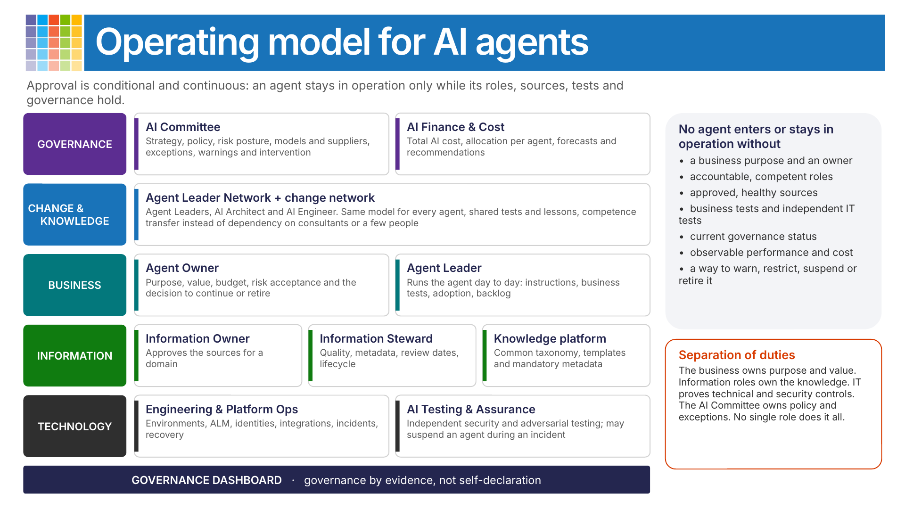
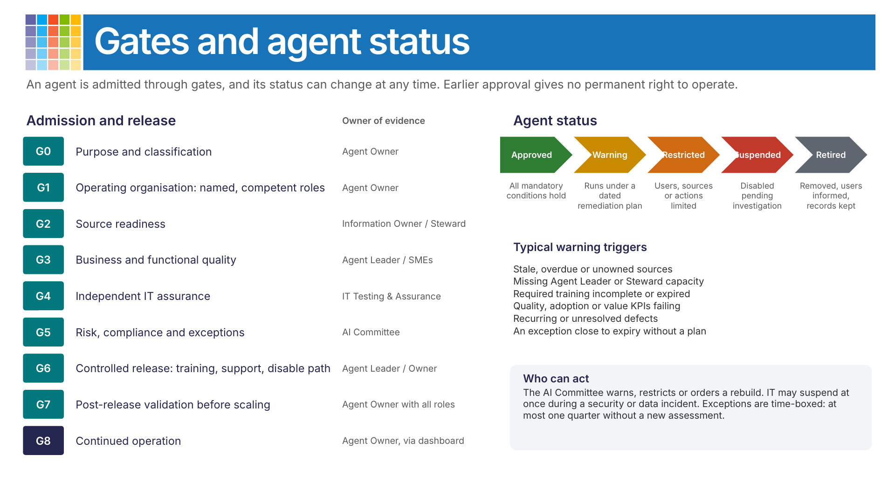
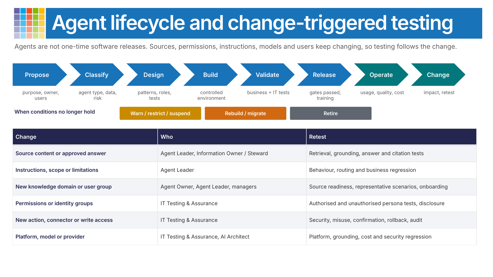
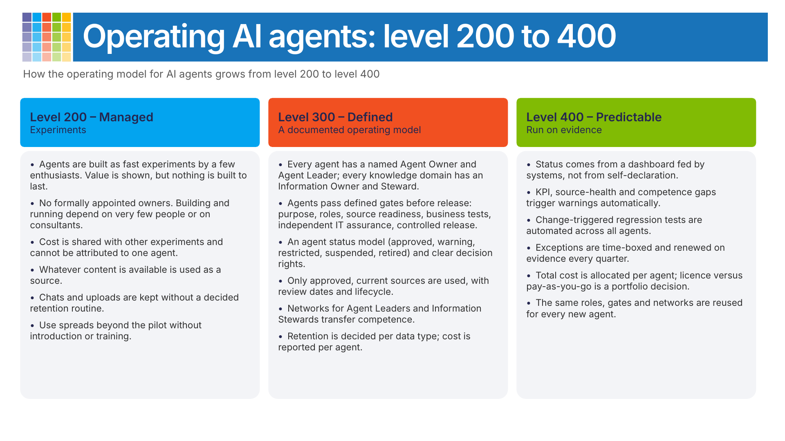

# Operating AI Agents – the organisation around them

[!INCLUDE [content-disclaimer](../includes/content-disclaimer.md)]

This article supports the [AI & Cognitive Business Competency](microsoft365-maturity-model--cognitive-business.md). It describes what an organisation needs around its AI agents once they move beyond experiments: who owns them, who decides what, how an agent is admitted into use, and how it stays there. It is written for knowledge agents built with Microsoft 365 Copilot and Copilot Studio, but the roles and controls apply to any AI technology.

The content is drawn from practice: an organisation that had shown the value of a knowledge agent through a short pilot, and then had to describe how the agent – and the agents that followed – would be run in the line.

## Why agents need an operating model

Agents are not one-time software releases. Their behaviour depends on information, permissions, instructions, platform capabilities, models, integrations, users and the competence of the people around them, and all of these keep changing. Approval is therefore **conditional and continuous**: an agent stays in operation only while the conditions it was approved on remain valid.

A practical rule: no agent enters or stays in operation without

- a business purpose and an accountable owner
- accountable and competent roles
- approved, demonstrably healthy sources
- business testing and independent technical testing
- a current governance status
- observable performance and cost
- a working way to warn, restrict, suspend, rebuild, migrate or retire it

## The operating model

| Layer | Role | Accountable for |
|---|---|---|
| Governance | **AI Committee** | AI strategy, policy, risk posture, choice of models and suppliers, exceptions, warnings and intervention across all agents. |
| Governance | **AI Finance & Cost** | Total AI cost, allocation of shared platform cost to each agent and business area, forecasts and recommendations. |
| Change and knowledge | **Agent Leader Network** | Agent Leaders, an AI Architect and AI Engineers. Turns policy and platform changes into actions for each agent, shares tests and lessons, and transfers competence. |
| Change and knowledge | **Change network** | Manager briefings, user onboarding, feedback loops and adoption, so that use does not depend on one person. |
| Business | **Agent Owner** | Purpose, value, budget, acceptance of residual business risk, and the decision to continue, scale or retire the agent. |
| Business | **Agent Leader** | Runs the agent day to day: instructions, representative business tests, adoption, training, defects and the improvement backlog. |
| Information | **Information Owner** | Owns and approves the information in a domain, and makes sure there is capacity to keep it current. |
| Information | **Information Steward** | Quality, metadata, review dates, lifecycle, archiving and removal of redundant, obsolete and trivial (ROT) content. |
| Information | **Knowledge platform** (often intranet or communications) | Common taxonomy, site and page templates, mandatory metadata. Owns the structure, not the business content. |
| Technology | **Engineering & Platform Operations** | Environments, application lifecycle management, identities, integrations, monitoring, incidents and recovery. |
| Technology | **AI Testing & Assurance** | Independent security, adversarial and prompt-injection testing using a common framework. May suspend an agent during an incident. |

Across all layers sits a **governance dashboard**: evidence about agents, sources, competence, tests, cost and exceptions generated from the systems themselves wherever possible. Governance by evidence, not self-declaration.

**Separation of duties.** The business defines the purpose and contributes business scenarios. Information roles secure and approve the knowledge. IT independently proves the technical and security controls. The AI Committee governs common policy and exceptions. No single role substitutes for all the others.

> [!TIP]
> The hardest part is rarely the technology. Roles that are only *suggested* and never formally appointed are the most common reason an agent cannot leave the pilot stage. Treat named, competent owners as a release condition, not a follow-up.

## Gates and agent status

| Gate | Required outcome | Owner of evidence |
|---|---|---|
| G0 Purpose and classification | Purpose, users, scope, value, risk and agent type defined. | Agent Owner |
| G1 Operating organisation | Named, competent Agent Owner, Agent Leader, Information Owners and Stewards, technical contact and escalation route. | Agent Owner |
| G2 Source readiness | Sources approved, current, permission-tested, lifecycle-controlled and reportable. | Information Owner / Steward |
| G3 Business and functional quality | Representative business behaviour and implemented functionality tested. | Agent Leader / subject-matter experts |
| G4 Independent IT assurance | Technical, security, adversarial and platform tests passed, proportionate to the agent's reach and risk. | AI Testing & Assurance |
| G5 Risk, compliance and exceptions | Required assessments complete; any exceptions approved and dated. | AI Committee |
| G6 Controlled release | Users, managers, training, communication, support, monitoring and a way to disable the agent are ready. | Agent Leader / Agent Owner |
| G7 Post-release validation | Real-use quality, adoption, defects, source health, cost and value reviewed before scaling. | Agent Owner with all roles |
| G8 Continued operation | Roles, competence, sources, KPIs, tests and exceptions remain current. | Agent Owner, through the dashboard |

An approved agent can change status at any time:

| Status | Meaning |
|---|---|
| Approved | All mandatory conditions hold. |
| Warning | Operation continues under a dated remediation plan. |
| Restricted | Users, sources, features or actions are limited. |
| Suspended | Operation is disabled pending investigation or action. |
| Retired | Removed from use; users informed, connections disabled, records kept. |

Typical warning triggers are stale or unowned sources, missing Agent Leader or Steward capacity, incomplete training, failing quality or adoption KPIs, recurring defects, and an exception close to expiry. The AI Committee warns, restricts or orders a rebuild; IT may suspend at once during a security, privacy or data incident. Exceptions are time-boxed and should not run longer than a quarter without a new assessment.

## Lifecycle and change-triggered testing

The lifecycle runs **propose → classify → design → build → validate → release → operate → change**, with **warn/restrict/suspend**, **rebuild/migrate** and **retire** as exits when the conditions no longer hold.

Testing follows the change rather than the calendar. For question-and-answer knowledge agents the primary test objective is the sources: does the agent retrieve, combine and present approved information correctly?

| Change | Who leads | Retest |
|---|---|---|
| Source content or approved answer | Agent Leader, Information Owner / Steward | Retrieval, grounding, answer and citation tests |
| Instructions, scope or limitations | Agent Leader | Behaviour, routing and business regression |
| New knowledge domain or user group | Agent Owner, Agent Leader, managers | Source readiness, representative scenarios, onboarding |
| Permissions or identity groups | AI Testing & Assurance | Authorised and unauthorised persona tests, unintended disclosure |
| New action, connector or write access | AI Testing & Assurance | Security, misuse, confirmation, rollback and audit |
| Platform, model or provider | AI Testing & Assurance, AI Architect | Platform, grounding, cost and security regression |

## Data that agents create

Users describe cases and upload screenshots, so personal data passes through agent conversations. Every data type – agent transcripts, session data, attached files, files uploaded in Copilot Chat, Copilot interactions and escalations – needs a known location, a decided retention period, an owner and a deletion routine that is checked. Microsoft's defaults change, so check the current documentation and your own tenant settings:

- [Control transcript access and retention (Copilot Studio)](https://learn.microsoft.com/microsoft-copilot-studio/admin-transcript-controls)
- [Learn about retention for Copilot & AI apps (Microsoft Purview)](https://learn.microsoft.com/purview/retention-policies-copilot)

## How this maps to maturity levels

| Level | What it looks like |
|---|---|
| 200 – Managed | Agents are built as fast experiments by a few enthusiasts. Value is shown, but nothing is built to last: no formally appointed owners, cost shared with other experiments, whatever content is available is used as a source, and chats and uploads are kept without a retention routine. |
| 300 – Defined | A documented operating model. Every agent has a named Agent Owner and Agent Leader, every knowledge domain an Information Owner and Steward. Agents pass defined gates before release, have a status, and are tested by the business and independently by IT. Networks transfer competence. |
| 400 – Predictable | The model runs on evidence. Status comes from a dashboard fed by systems, KPI and source-health gaps trigger warnings, regression tests are automated, exceptions are renewed on evidence, and total cost is allocated per agent so that licence versus pay-as-you-go becomes a portfolio decision. |

## Common Microsoft 365 toolsets

- Microsoft 365 Copilot and Copilot Studio
- SharePoint (knowledge sources, templates, metadata, lifecycle)
- Microsoft Purview (retention, sensitivity labels, data lifecycle management)
- Microsoft Entra ID (groups, identities for agents and connectors)
- Microsoft Power Platform admin center (environments, application lifecycle management)

[!INCLUDE [mm4m365-practitioners](../includes/mm4m365-practitioners.md)]

---

**Principal authors**:

- [Pia Langenkrans, MVP](https://github.com/mrsbeata)

---

[!INCLUDE [mm4m365-core-team](../includes/mm4m365-core-team.md)]
