# Practical Scenarios - AI Operations

[!INCLUDE [content-disclaimer](../includes/content-disclaimer.md)]

The Maturity Model for Microsoft 365 is a useful tool for considering high level business capabilities and competencies, providing benchmarking, and planning guidance. However, practical application of the Maturity Model to specific tasks and needs is not addressed in the Competency or Elevate documents.

This Practical Scenario covers **AI Operations**: the organisation an enterprise needs around its AI agents once they leave the pilot stage. Who owns an agent, who decides what, how an agent is admitted into use, how it stays there, and how it is retired. It follows on from [Implementing Microsoft 365 Copilot Organization-Wide](maturity-model-microsoft365-practical-scenarios-copilot-implementation.md): that scenario is about getting people to use AI; this one is about running the agents they come to depend on.

## Read this as a system of generalisations

This scenario describes a system, not a recipe. Every organisation will need to adapt it to its own size, regulation, platforms and existing roles. Many roles described here are additions to existing jobs, not new positions.

The content is drawn from practice in an organisation that had shown the value of a knowledge agent in a short pilot and then had to describe how that agent, and the agents that followed, would be run in the line. That organisation had decided to use one platform and one repository for its first agents. In reality, architects will manage a landscape of agents that are **built, bought and rented**, on several platforms and over many repositories. The scenario is written for that landscape.

## Why do we need an AI operating model?

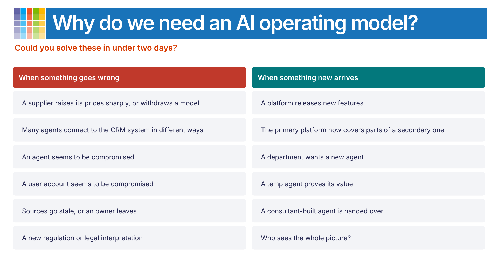

Could you solve these in under two days?

**When something goes wrong**

- A supplier raises its prices sharply, or withdraws a model
- Many agents connect to the CRM system in different ways
- An agent seems to be compromised
- A user account seems to be compromised
- Sources go stale, or an owner leaves
- A new regulation or legal interpretation

**When something new arrives**

- A platform releases new features
- The primary platform now covers parts of a secondary one
- A department wants a new agent
- A temp agent proves its value
- A consultant-built agent is handed over
- Who sees the whole picture?

### It is not one thing

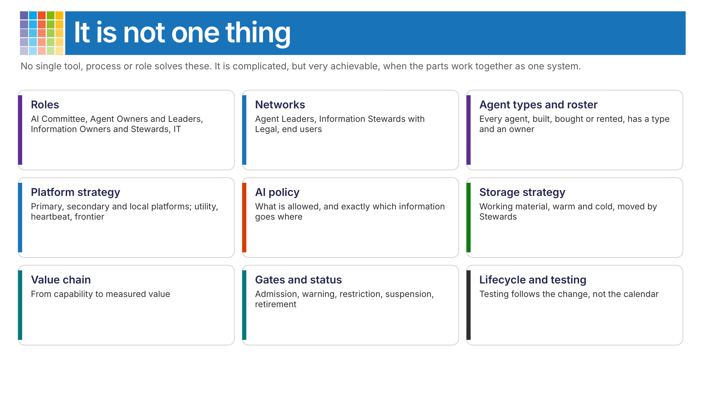

No single tool, process or role solves these. It is complicated, but very achievable, when the parts work together as one system: roles, networks, agent types and an agent roster, a platform strategy, an AI policy, a storage strategy, a value chain for every agent, gates and status, and a lifecycle where testing follows the change. The sections below explain each part, and [the scenarios, solved](#the-scenarios-solved) shows how they work together.

## How AI Operations connects to the competencies

AI Operations does not belong to a single competency. That is why it is a Practical Scenario.

| Competency | What AI Operations draws on |
|---|---|
| [AI & Cognitive Business](../competencies/microsoft365-maturity-model--cognitive-business.md) | Strategy, responsible use, the limits of AI, the move from tools to agents |
| [Governance, Risk, and Compliance](../competencies/microsoft365-maturity-model--governance-and-compliance.md) | AI Committee, AI policy, exceptions, agent status, regulation such as the EU AI Act |
| [Management of Content](../competencies/microsoft365-maturity-model--management-of-content.md) | Information Owners and Stewards, source quality, lifecycle, active and archived content |
| [Staff & Training](../competencies/microsoft365-maturity-model--staff-and-training.md) | AI literacy, role competence for Agent Owners, Agent Leaders and Stewards |
| [People and Communities](../competencies/microsoft365-maturity-model--people-and-communities-competency.md) | The three networks that carry change and knowledge |
| [Business Process](../competencies/microsoft365-maturity-model--business-process.md) | Agent Owners who own the process the agent supports, and its value |
| [Customization and Development](../competencies/microsoft365-maturity-model--customization-and-development.md) | Build, buy or rent; application lifecycle management; rebuilding agents on a new platform |
| [Security](../competencies/microsoft365-maturity-model-security.md) and [Infrastructure](../competencies/microsoft365-maturity-model--infrastructure.md) | Identities, access, independent testing, incidents, platform operations |

## What makes an agent different

An agent does not behave like a traditional IT system, and not like an employee either.

| Traditional IT system | Person | AI agent |
|---|---|---|
| Exact input gives exact output | Uses own judgement | Creative in between |
| Configured once | Develops continuously | Needs continuous maintenance |
| IT owns and manages it | Manager and HR are responsible | The business has to own it |
| Versioned | Learns from experience | Models are replaced and change |

Neither ordinary system management nor ordinary line management is enough. An agent's behaviour depends on information, permissions, instructions, platforms, models, integrations, users and the competence of the people around it, and all of these keep changing. Approval is therefore **conditional and continuous**: an agent stays in operation only while the conditions it was approved on remain valid.

No agent enters or stays in operation without

- a business purpose and an accountable owner
- accountable and competent roles
- approved, demonstrably healthy sources
- business testing and independent technical testing
- a current governance status
- observable performance and cost
- a working way to warn, restrict, suspend, rebuild, migrate or retire it

## The operating model

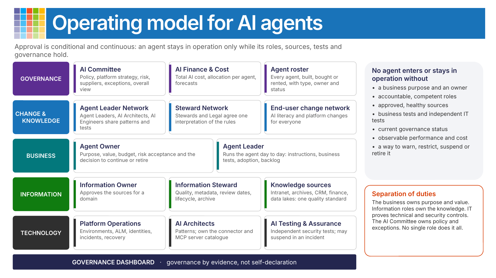

| Layer | Role | Accountable for |
|---|---|---|
| Governance | **AI Committee** | AI strategy, AI policy and platform strategy, risk posture, choice of models and suppliers, exceptions, warnings and intervention across all agents. Holds the overall view of usage, surveys, follow-up and cost for all agents and platforms, against common KPIs, with input from the networks. Think of it as strategic HR for agents: it sets the frame and supports everyone who builds them. |
| Governance | **AI Finance & Cost** | Total AI cost, allocation of shared platform cost to each agent and business area, forecasts and recommendations. |
| Governance | **Agent roster** | Owned by the AI Committee. Every agent, whether built, bought or rented: type, owner, Agent Leader, platform, sources, users, status, cost and end date. |
| Business | **Agent Owner** | Purpose, value, budget, acceptance of residual business risk, and the decision to continue, scale or retire the agent. Usually an addition to a business-development role, not a new job. Makes sure the agent has an Agent Leader and an Information Steward. |
| Business | **Agent Leader** | Runs the agent day to day: instructions, playbooks, representative business tests, KPIs, adoption, training, defects and the improvement backlog. Usually a fraction of a role. Complex agents also need an IT person. |
| Information | **Information Owner** | Owns and approves the information in a domain, and makes sure there is capacity to keep it current. |
| Information | **Information Steward** | Quality through the whole information lifecycle: metadata and naming standards, review dates, no duplicates, archiving, removal of redundant, obsolete and trivial (ROT) content. Works closely with compliance. Does not need to know AI. |
| Information | **Knowledge sources** | Every repository an agent uses, whether intranet, archive, file server, CRM, finance system or data lake, is held to the same quality standard. An available document is not automatically an approved source. |
| Technology | **Platform Operations** | Environments, application lifecycle management, identities, integrations, monitoring, incidents and recovery. |
| Technology | **AI Architects** | Architecture patterns across platforms, and the catalogue of approved connectors and MCP servers. The goal is to streamline and automate as much as possible. |
| Technology | **AI Testing & Assurance** | Independent security, adversarial and prompt-injection testing using a common framework. May suspend an agent during an incident. |

Across all layers sits a **governance dashboard**: evidence about agents, sources, competence, tests, cost and exceptions, generated from the systems themselves wherever possible. Governance by evidence, not self-declaration.

**Separation of duties.** The business defines the purpose and contributes business scenarios. Information roles secure and approve the knowledge. IT independently proves the technical and security controls. The AI Committee governs common policy and exceptions. No single role substitutes for all the others.

When several agents use the same information, for example a shared archive or a data lake, the dependency on that information's Steward must be explicit, so that roles are not duplicated or left unclear.

## Three networks carry change and knowledge

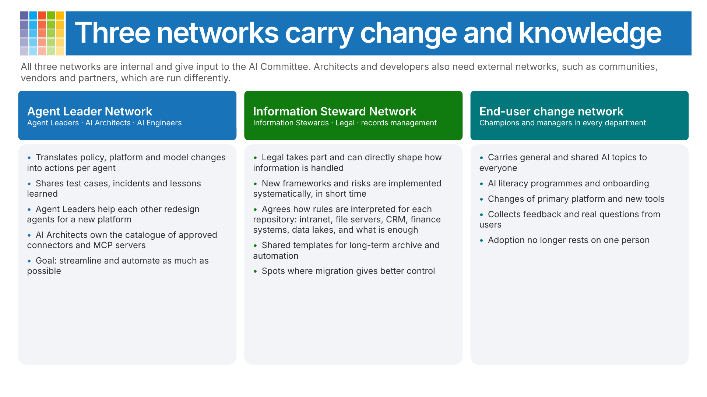

**Agent Leader Network.** Agent Leaders, AI Architects and AI Engineers. Translates policy, platform and model changes into actions for each agent, shares test cases, defects and lessons, and coordinates rebuilds and migrations. The AI Architects own the catalogue of approved connectors and MCP servers.

**Information Steward Network.** A change and knowledge network for Information Stewards, with Legal and records management taking part. Because Legal is in the network, Legal can directly shape how information is handled, and changes in frameworks or risks can be implemented systematically in a short time. Different repositories (SharePoint, file servers, CRM systems, finance systems, data lakes) have different functions and features, so the network agrees how rules are interpreted for each of them and what is enough. That work also shows where a migration would give better control. The network keeps shared ways of working and templates for long-term archive and automation.

**End-user change network.** Champions and managers in every department. Carries general and shared AI topics to everyone: AI literacy programmes, onboarding, and changes such as a new primary platform. Collects feedback and real questions from users, so adoption no longer rests on one person.

All three networks are internal and give input to the AI Committee. Architects and developers also need networks outside the organisation, such as communities, vendors and partners. Those are run differently and are not part of this operating model.

## Agent types: like forms of employment

The AI Committee is like strategic HR, the Agent Owner is the manager and the Agent Leader is the mentor.

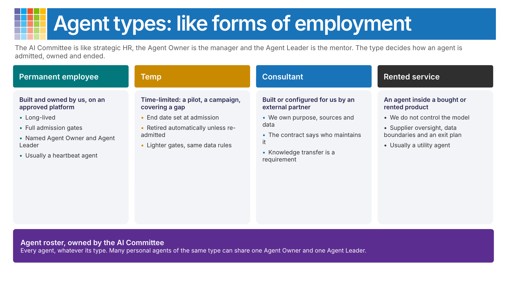

The type of an agent decides how it is admitted, owned and ended. All four need an owner and every agent is in the agent roster. Many personal agents will be of the same type; they can be handled more efficiently by appointing one Agent Owner and one Agent Leader for the group.

| Type | What it is | How it is governed |
|---|---|---|
| Permanent employee | Built and owned by us, on an approved platform | Long-lived, full admission gates, named Agent Owner and Agent Leader. Usually a heartbeat agent. |
| Temp | Time-limited: a pilot, a campaign, covering a gap | End date set at admission; retired automatically unless re-admitted. Lighter gates, same data rules. |
| Consultant | Built or configured for us by an external partner | We own the purpose, the sources and the data. The contract says who maintains it, and knowledge transfer is a requirement. |
| Rented service | An agent inside a bought or rented product | We do not control the model. Governed through supplier oversight, data boundaries and an exit plan. Usually a utility agent. |

## Example of a platform strategy

The platform strategy is one of the artefacts the AI Committee owns. The AI policy points to it.

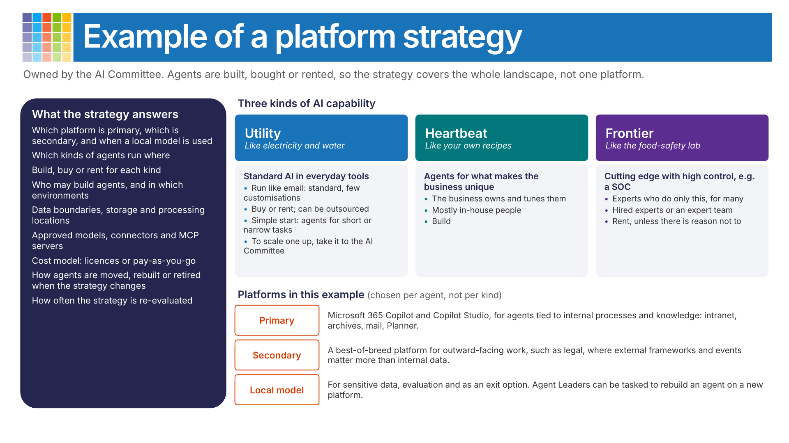

### What a platform strategy answers

- Which platform is primary, which is secondary, and when a local model is used
- Which kinds of agents run where
- Build, buy or rent for each kind
- Who may build agents, and in which environments
- Data boundaries, storage and processing locations
- Approved models, connectors and MCP servers
- Cost model: licences or pay-as-you-go
- How agents are moved, rebuilt or retired when the strategy changes
- How often the strategy is re-evaluated

### Three kinds of AI capability

| | Utility | Heartbeat | Frontier |
|---|---|---|---|
| Think of it as | Electricity and water | Your own recipes | The food-safety lab |
| What it is | Standard AI in everyday tools, used by everyone | Agents for the processes and knowledge that make the business unique | Cutting-edge capability with high control |
| How to run it | Like email: stable, standard, few customisations. A simple start: anyone can build agents for short or narrow tasks, and to scale one up, take it to the AI Committee | The business owns it and keeps tuning it | Experts who do only this, for many organisations |
| People | Can be outsourced | Mostly in-house: this knowledge is the advantage | Hired experts, or a dedicated expert team if the department is big enough |
| Source | Buy or rent | Build | Rent, unless there is reason to keep it in-house |

You cannot hire one expert and expect them to stay at the frontier on their own. A security operations centre (SOC) is a typical frontier capability: if you do not have enough reason to run it in-house, it is better placed with a provider that does only this, for many customers.

### Platforms in this example

Platforms are chosen per agent, not per kind of capability.

- **Primary platform: Microsoft 365 Copilot and Copilot Studio**, for agents closely tied to internal processes and knowledge in the intranet, archives, mail, Planner and similar.
- **Secondary platform: a best-of-breed platform**, for outward-facing work such as legal, where external frameworks and events matter more than internal information.
- **Local model**, for sensitive data, for evaluation, and as an exit option.

There should always be room to evaluate alternatives. When the strategy changes, Agent Leaders can be given the task of rebuilding their agent on a new platform.

## Example of an AI policy

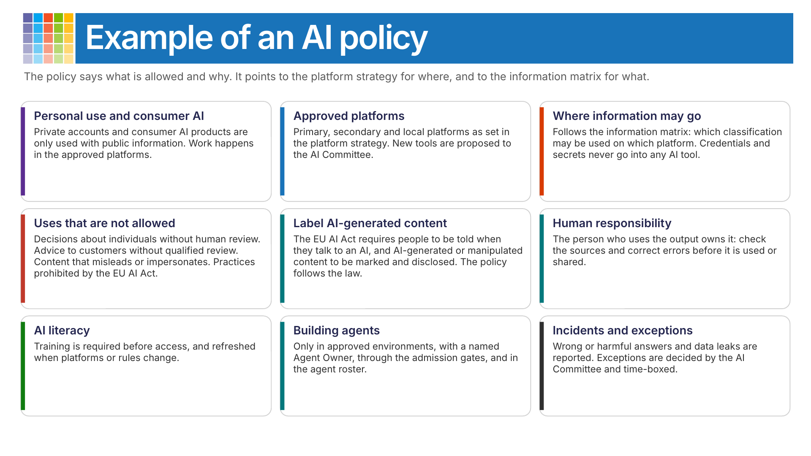

The AI policy says what is allowed and why. It points to the platform strategy for where, and to an information matrix for what. An example policy covers:

| Area | Example content |
|---|---|
| Personal use and consumer AI | Private accounts and consumer AI products are only used with public information. Work happens in the approved platforms. |
| Approved platforms | Primary, secondary and local platforms as set in the platform strategy. New tools are proposed to the AI Committee. |
| Where information may go | Follows the information matrix below. Credentials and secrets never go into any AI tool. |
| Uses that are not allowed | Decisions about individuals without human review. Advice to customers without qualified review. Content that misleads or impersonates. Practices prohibited by the EU AI Act. |
| Label AI-generated content | The [EU AI Act, Article 50](https://artificialintelligenceact.eu/article/50/), requires that people are told when they interact with an AI system, that AI-generated content is marked as such, and that deepfakes and AI-generated text published to inform the public are disclosed. The policy follows these requirements. |
| Human responsibility | The person who uses the output owns it: check the sources and correct errors before it is used or shared. |
| AI literacy | Training is required before access, and refreshed when platforms or rules change. |
| Building agents | Only in approved environments, with a named Agent Owner, through the admission gates, and recorded in the agent roster. |
| Incidents and exceptions | Wrong or harmful answers and data leaks are reported. Exceptions are decided by the AI Committee and time-boxed. |

### Where information may go

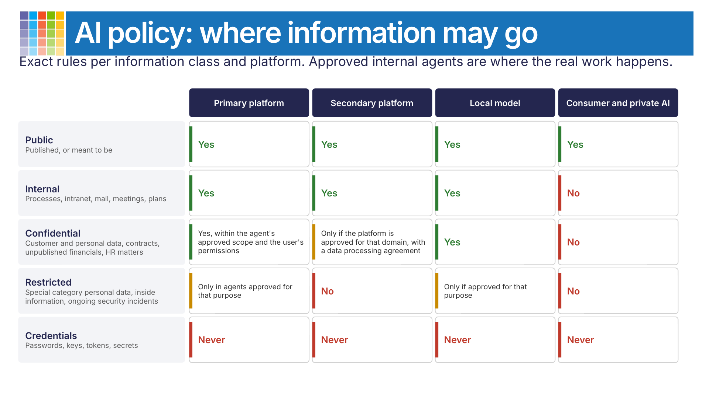

The approved internal platforms are where the real work happens, so the policy has to be exact about what may be used where.

| Information class | Primary platform | Secondary platform | Local model | Consumer and private AI |
|---|---|---|---|---|
| **Public**: published, or meant to be | Yes | Yes | Yes | Yes |
| **Internal**: processes, intranet, mail, meetings, plans | Yes | Yes | Yes | No |
| **Confidential**: customer and personal data, contracts, unpublished financials, HR matters | Yes, within the agent's approved scope and the user's permissions | Only if the platform is approved for that domain, with a data processing agreement | Yes | No |
| **Restricted**: special category personal data, inside information, ongoing security incidents | Only in agents approved for that purpose | No | Only if approved for that purpose | No |
| **Credentials**: passwords, keys, tokens, secrets | Never | Never | Never | Never |

## Example of a storage strategy

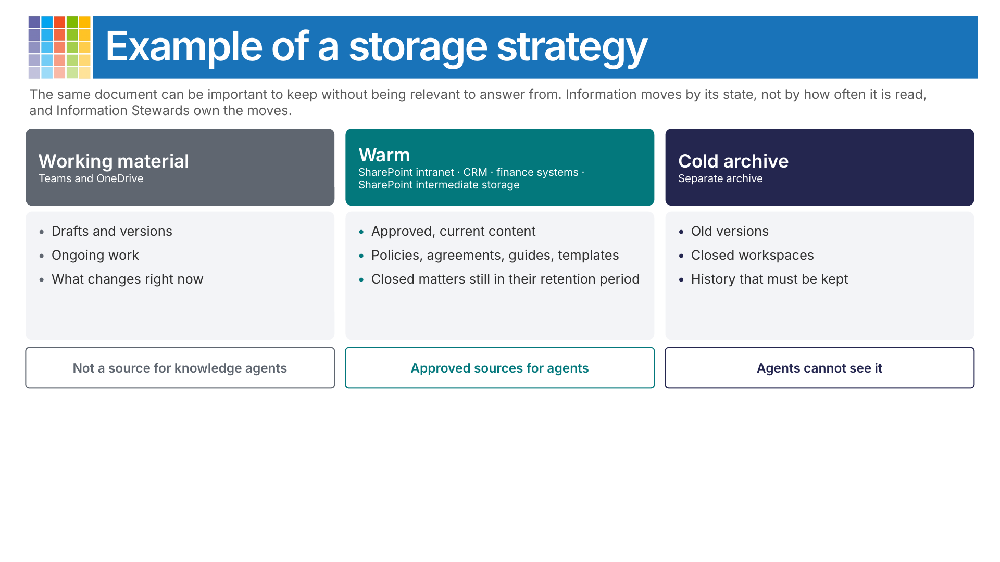

The same document can be important to keep without being relevant to answer from. An example storage strategy has three states:

| | Working material | Warm | Cold archive |
|---|---|---|---|
| Where | Teams and OneDrive | SharePoint intranet, CRM system, finance systems, SharePoint intermediate storage | A separate archive |
| What | Drafts, versions, ongoing work | Approved, current content: policies, agreements, guides, templates; closed matters still in their retention period | Old versions, closed workspaces, history that must be kept |
| Agents | Not a source for knowledge agents | Approved sources for agents | Agents cannot see it |

Information is moved by its state, not by how often it is read. The storage strategy is shared with the [Management of Content Competency](../competencies/microsoft365-maturity-model--management-of-content.md).

## How Information Stewards move information

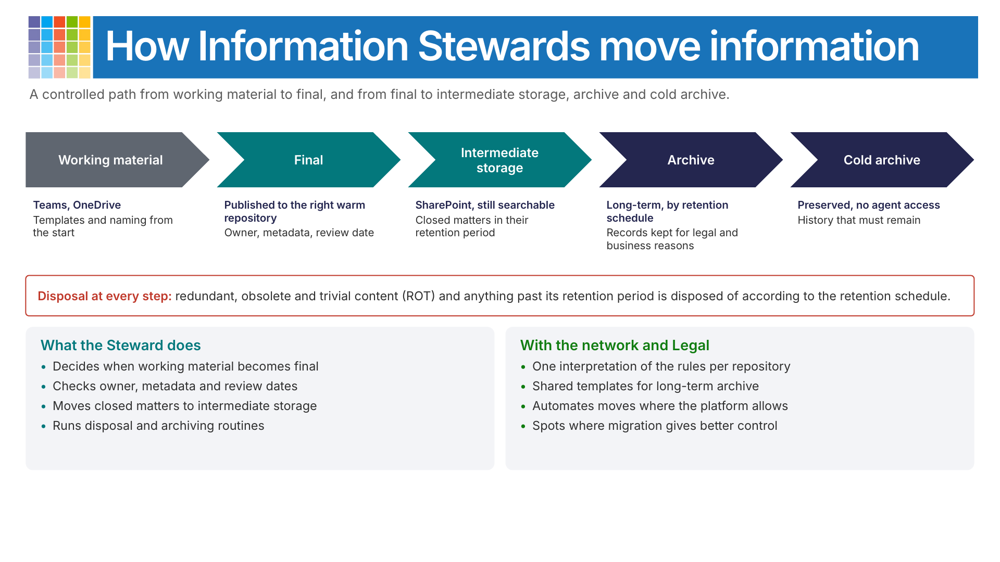

Information Stewards have a process that moves information from **working material** to **final**, and from final to **intermediate storage**, **archive** and **cold archive**.

| Step | Where | What happens |
|---|---|---|
| Working material | Teams, OneDrive | Templates and naming standards are used from the start. |
| Final | The right warm repository | Published with owner, metadata and review date. |
| Intermediate storage | SharePoint, still searchable | Closed matters stay here during their retention period. |
| Archive | Long-term archive | Records kept for legal and business reasons, according to the retention schedule. |
| Cold archive | Preserved, no agent access | History that must remain. |

Disposal happens at every step: redundant, obsolete and trivial content and anything past its retention period is disposed of according to the retention schedule. The Steward decides when working material becomes final, checks owners, metadata and review dates, and runs the disposal and archiving routines. In the Information Steward Network, with Legal, the Stewards agree one interpretation of the rules per repository, share templates for long-term archive, and automate the moves where the platform allows.

## From capability to value

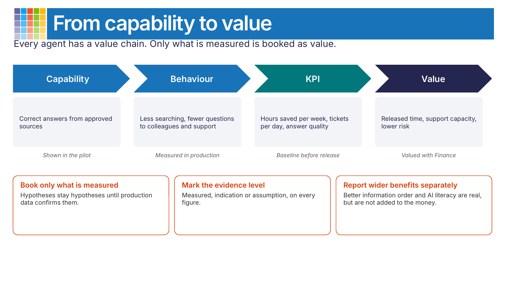

Every agent has a value chain, and the Agent Owner is accountable for it.

| | Capability | Behaviour | KPI | Value |
|---|---|---|---|---|
| Example | Correct answers from approved sources | Less searching, fewer questions to colleagues and support | Hours saved per week, tickets per day, answer quality | Released time, support capacity, lower risk |
| Evidence | Shown in the pilot | Measured in production | Baseline before release | Valued with Finance |

Three rules keep the value honest:

- **Book only what is measured.** Hypotheses stay hypotheses until production data confirms them.
- **Mark the evidence level** on every figure: measured, indication or assumption.
- **Report wider benefits separately.** Better order in information and higher AI literacy are real benefits, but they are not added to the money, so nothing is counted twice.

## Gates and agent status

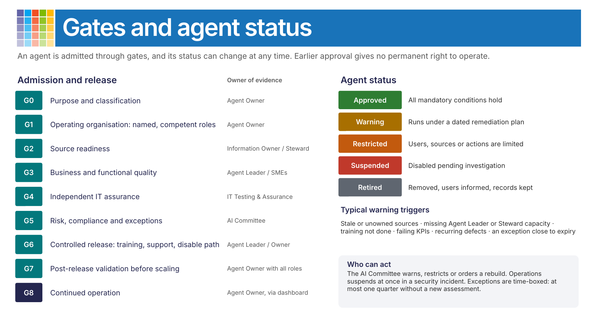

| Gate | Required outcome | Owner of evidence |
|---|---|---|
| G0 Purpose and classification | Purpose, users, scope, value, risk and agent type defined. | Agent Owner |
| G1 Operating organisation | Named, competent Agent Owner, Agent Leader, Information Owners and Stewards, technical contact and escalation route. | Agent Owner |
| G2 Source readiness | Sources approved, current, permission-tested, lifecycle-controlled and reportable. | Information Owner / Steward |
| G3 Business and functional quality | Representative business behaviour and implemented functionality tested. | Agent Leader / subject-matter experts |
| G4 Independent IT assurance | Technical, security, adversarial and platform tests passed, proportionate to the agent's reach and risk. | AI Testing & Assurance |
| G5 Risk, compliance and exceptions | Required assessments complete; any exceptions approved and dated. | AI Committee |
| G6 Controlled release | Users, managers, training, communication, support, monitoring and a way to disable the agent are ready. | Agent Leader / Agent Owner |
| G7 Post-release validation | Real-use quality, adoption, defects, source health, cost and value reviewed before scaling. | Agent Owner with all roles |
| G8 Continued operation | Roles, competence, sources, KPIs, tests and exceptions remain current. | Agent Owner, through the dashboard |

An approved agent can change status at any time:

| Status | Meaning |
|---|---|
| Approved | All mandatory conditions hold. |
| Warning | Operation continues under a dated remediation plan. |
| Restricted | Users, sources, features or actions are limited. |
| Suspended | Operation is disabled pending investigation or action. |
| Retired | Removed from use; users informed, connections disabled, records kept. |

Typical warning triggers are stale or unowned sources, missing Agent Leader or Steward capacity, incomplete training, failing quality or adoption KPIs, recurring defects, and an exception close to expiry. The AI Committee warns, restricts or orders a rebuild; IT may suspend at once during a security, privacy or data incident. Exceptions are time-boxed and should not run longer than a quarter without a new assessment.

## Lifecycle and change-triggered testing

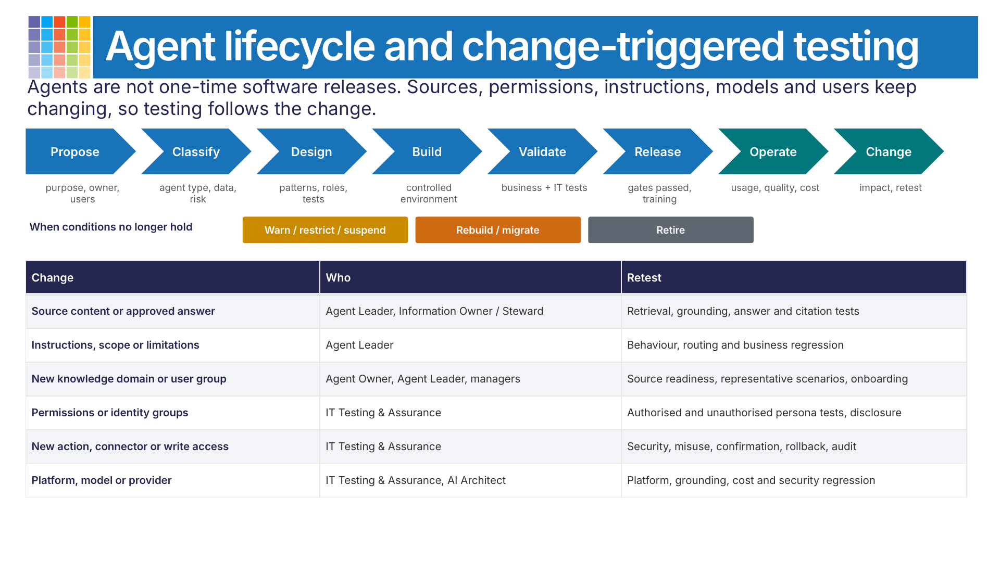

The lifecycle runs **propose → classify → design → build → validate → release → operate → change**, with **warn/restrict/suspend**, **rebuild/migrate** and **retire** as exits when the conditions no longer hold.

Testing follows the change rather than the calendar. For question-and-answer knowledge agents the primary test objective is the sources: does the agent retrieve, combine and present approved information correctly?

| Change | Who leads | Retest |
|---|---|---|
| Source content or approved answer | Agent Leader, Information Owner / Steward | Retrieval, grounding, answer and citation tests |
| Instructions, scope or limitations | Agent Leader | Behaviour, routing and business regression |
| New knowledge domain or user group | Agent Owner, Agent Leader, managers | Source readiness, representative scenarios, onboarding |
| Permissions or identity groups | AI Testing & Assurance | Authorised and unauthorised persona tests, unintended disclosure |
| New action, connector or write access | AI Testing & Assurance | Security, misuse, confirmation, rollback and audit |
| Platform, model or provider | AI Testing & Assurance, AI Architects | Platform, grounding, cost and security regression |

## Data that agents create

Users describe cases and upload screenshots, so personal data passes through agent conversations. Every data type (agent transcripts, session data, attached files, uploaded files, AI interactions and escalations) needs a known location, a decided retention period, an owner and a deletion routine that is checked. Legal decides the retention together with the Information Owners, and the AI Committee adopts it as policy. Platform defaults change, so check the current documentation and your own settings. For Microsoft 365:

- [Control transcript access and retention (Copilot Studio)](https://learn.microsoft.com/microsoft-copilot-studio/admin-transcript-controls)
- [Learn about retention for Copilot & AI apps (Microsoft Purview)](https://learn.microsoft.com/purview/retention-policies-copilot)

## The scenarios, solved

With the operating model in place, each of the situations from the start of this scenario becomes a routine decision with an owner and an end date.

### When something goes wrong

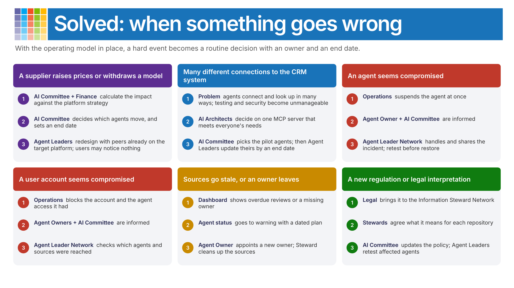

**A supplier raises its prices sharply, or withdraws a model.** The AI Committee and AI Finance & Cost take the task and calculate the impact. With the platform strategy as the basis, the AI Committee decides to move a set of agents from one platform to another and gives the Agent Owners an end date. Agent Leaders get help to redesign their agents from other Agent Leaders whose agents already run on the target platform. End users may not notice anything.

**Many agents have different kinds of connections and lookups to the CRM system.** Keeping many different connections tested and secure becomes unsustainable. The AI Architects decide that one MCP server should be built that meets everyone's needs and is simpler to work with going forward. It is tried with a few agents first; the AI Committee, not the Agent Owners, decides which. The Agent Leaders then update their agents by an end date.

**An agent seems to be compromised.** Operations suspends the agent and reports to the Agent Owner and the AI Committee. The incident is shared and handled in the Agent Leader Network, and the agent is retested before it is restored.

**A user account seems to be compromised.** The same path: Operations blocks the account and the agent access it had, reports to the Agent Owners and the AI Committee, and the Agent Leader Network checks which agents and sources the account reached.

**Sources go stale, or an owner leaves.** The dashboard shows overdue reviews or a missing owner. The agent goes to warning status with a dated plan, the Agent Owner appoints a new owner, and the Information Steward cleans up the sources.

**A new regulation or a new legal interpretation.** Legal brings it to the Information Steward Network, where the Stewards agree what it means for each repository. The AI Committee updates the policy and the Agent Leaders retest the affected agents.

### When something new arrives

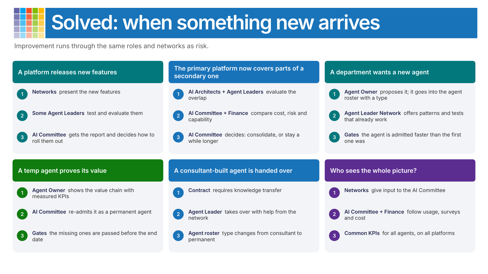

**A platform releases new features.** They are presented in the networks. Some Agent Leaders test and evaluate them and report to the AI Committee, which decides how they are rolled out.

**New AI capabilities in the primary platform cover parts of a secondary platform.** The AI Architects and Agent Leaders evaluate the overlap, the AI Committee and AI Finance & Cost compare cost, risk and capability, and the AI Committee decides whether to consolidate or stay a while longer.

**A department wants a new agent.** The Agent Owner proposes it and it goes into the agent roster with a type. The Agent Leader Network offers patterns and tests that already work, so the agent passes the gates faster than the first one did.

**A temp agent proves its value.** The Agent Owner shows the value chain with measured KPIs, and the AI Committee re-admits it as a permanent agent once the missing gates are passed.

**A consultant-built agent is handed over.** The contract requires knowledge transfer. An internal Agent Leader takes over with help from the network, and the agent's type in the register changes from consultant to permanent employee.

**Who sees the whole picture?** The networks give input to the AI Committee. The AI Committee, with AI Finance & Cost, holds the overall view of usage, surveys and follow-up for all agents, all platforms and all costs, measured against common and relevant KPIs.

## Applying the Maturity Model to AI Operations

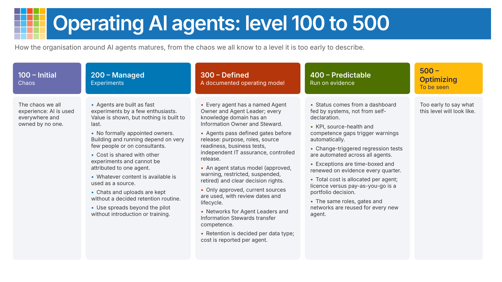

### Level 100 - Initial

The chaos we all experience: AI is used everywhere and owned by no one.

### Level 200 - Managed

#### 200 Characteristics

- Agents are built as fast experiments by a few enthusiasts. They show value quickly but are not built to last.
- No Agent Owner or Information Owner is formally appointed. Building and running the agent depend on very few people, or on external consultants.
- The cost of an agent is shared with other experiments and cannot be attributed to it.
- Whatever content is available is used as a source, whether or not it is approved, current or owned.
- Chats, transcripts and uploaded files are kept without a decided retention or deletion routine.
- Use spreads beyond the pilot group without introduction or training.

#### 200 Impacts

The value is visible, which creates demand for more agents. The risks grow at the same pace, and every new agent repeats the same dependency on a few people.

#### 200 Next Steps

- Set up the AI Committee and give it the AI policy and the platform strategy.
- Name an Agent Owner, an Agent Leader and an Information Steward for each agent in use.
- Separate the cost of each agent.
- Decide retention for chats, transcripts and uploads.

### Level 300 - Defined

#### 300 Characteristics

- Every agent has a named, competent Agent Owner and Agent Leader. Every knowledge domain an agent uses has an Information Owner and an Information Steward.
- Agents are admitted through defined gates before release, and have a status that can change.
- An AI policy and a platform strategy exist and are known. There is a primary platform, a secondary platform and a local option.
- Only approved, current sources with an owner, review date and lifecycle are connected to an agent, whatever the repository.
- The business tests the agent with representative questions; IT tests it independently. Tests are rerun when sources, instructions, permissions or the platform change.
- The Agent Leader Network, the Information Steward Network and the End-user change network are running.
- Every agent has a type and is recorded in the agent roster.
- Every agent has a value chain, from capability to valued benefit.
- Retention of agent data is decided per data type, and the cost of each agent is reported separately.

#### 300 Impacts

New agents are cheaper and safer to introduce than the first, because roles, gates and networks are reused. Competence stays in the organisation rather than with a few people or consultants.

#### 300 Next Steps

- Generate status from systems instead of collecting it manually.
- Automate the regression tests that are rerun after changes.
- Allocate total AI cost per agent and business area.

### Level 400 - Predictable

#### 400 Characteristics

- Agent, source, competence, test and cost status comes from a governance dashboard fed by systems, not from self-declaration.
- Failing KPIs, stale sources and competence gaps trigger warnings automatically, with a dated remediation plan.
- Change-triggered regression tests are automated and reused across all agents.
- Exceptions to AI policy are time-boxed and renewed on evidence, at least every quarter.
- Total AI cost is allocated per agent and business area, so that choices such as licences versus pay-as-you-go are made for the whole portfolio, not agent by agent.
- Built, bought and rented agents are governed in the same model; the connector and MCP server catalogue is the only route to data.

#### 400 Impacts

The organisation can change platform, model or supplier in a controlled way, because it knows which agents are affected and who rebuilds them.

### Level 500 - Optimizing

Too early to say what this level will look like.

## Related Documents

- [Maturity Model for Microsoft 365 - AI & Cognitive Business Competency](../competencies/microsoft365-maturity-model--cognitive-business.md)
- [Maturity Model for Microsoft 365 - Governance, Risk, and Compliance Competency](../competencies/microsoft365-maturity-model--governance-and-compliance.md)
- [Maturity Model for Microsoft 365 - Management of Content Competency](../competencies/microsoft365-maturity-model--management-of-content.md)
- [Maturity Model for Microsoft 365 - Staff & Training Competency](../competencies/microsoft365-maturity-model--staff-and-training.md)
- [Practical Scenarios - Implementing Microsoft 365 Copilot Organization-Wide](maturity-model-microsoft365-practical-scenarios-copilot-implementation.md)

---

**Principal author:**

- [Pia Langenkrans, MVP](https://www.linkedin.com/in/pialangenkrans/)

---

[!INCLUDE [mm4m365-core-team](../includes/mm4m365-core-team.md)]

